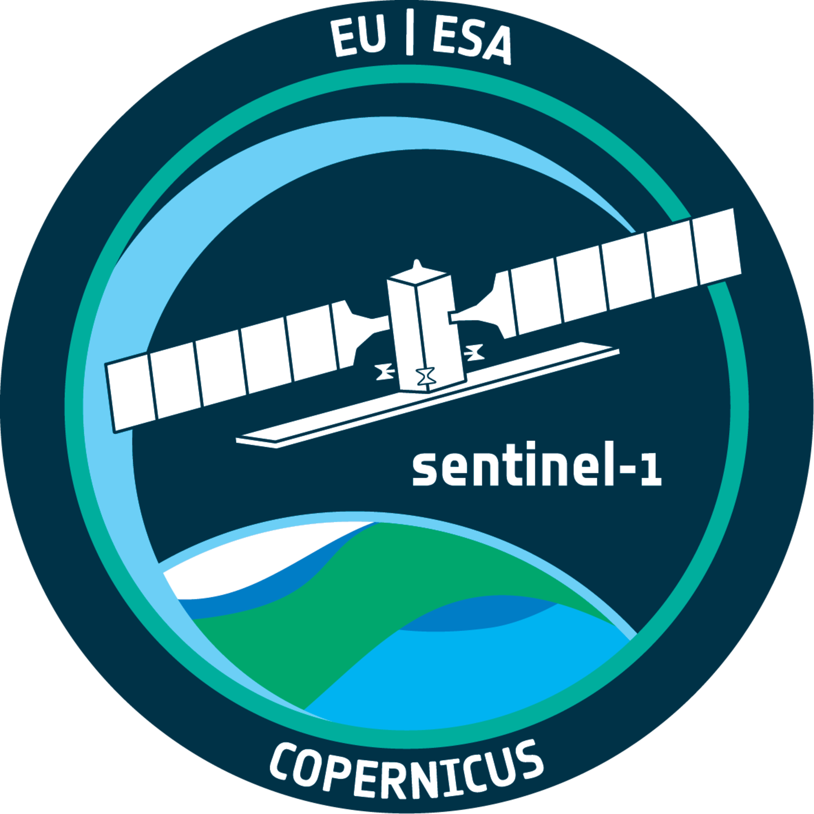
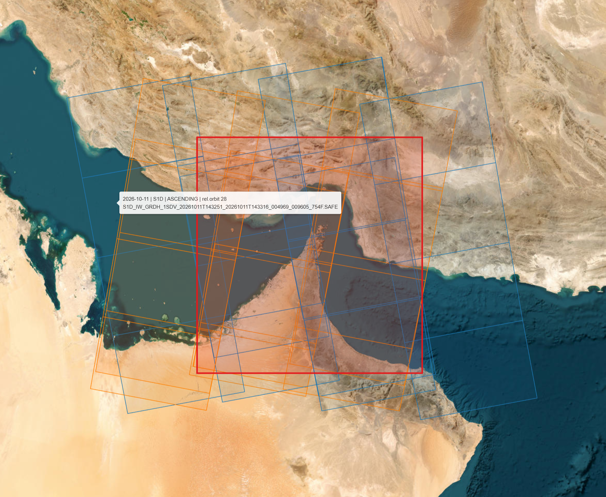

<table align="right">
  <tr>
    <td align="center">
      <a href="https://www.esa.int/Applications/Observing_the_Earth/Copernicus/Sentinel-1" target="_blank">
        
      </a>
      <br>
      <b>👤 Julian Manning</b>
      <br>
      <sub>♻️ Last updated: <b>October 2026</b></sub>
      <br>
      <sub>📝 <b>Sentinel-1 Download Workflow</b></sub>
      <br>
      <sub>📧 <a href="mailto:julian.manning@outlook.com">julian.manning@outlook.com</a></sub>
      <br>
      <sub>🔗 Connect on <a href="https://www.linkedin.com/in/julian-manning/">LinkedIn</a></sub>
    </td>
  </tr>
</table>

# 🧑‍💻 cdse-sentinel1-pipeline

A high-throughput, multithreaded Python pipeline for querying and downloading Sentinel-1 SAR products from the modern Copernicus Data Space Ecosystem (CDSE). It features SAR-aware product filtering (sensor mode, product type, polarisation, orbit direction, relative orbit), pass-level ROI coverage filtering that understands Sentinel-1's along-track slicing, a selection preview with footprint map and volume estimate, resumable downloads, a fully automated Conda/Jupyter environment setup, and batch extraction to analysis-ready `.SAFE` directories.

---

## 🛰️ The Problem: A Broken Ecosystem

If you work with satellite imagery, you likely know the bad news: the legacy **Copernicus Open Access Hub (SciHub) has been officially retired.** Almost overnight, hundreds of automated Python scripts and GIS pipelines broke, leaving developers scrambling to adapt to the new Copernicus Data Space Ecosystem (CDSE).

While the standard CDSE web portal is fine for downloading a few single scenes, teams tackling **complex study areas, large geographic boundaries, or extensive SAR time-series** need an automated, programmatic pipeline.

### Why not just use Cloud platforms (GEE, Planetary Computer)?
Cloud-native ecosystems have made basic SAR analysis accessible, but scaling professional radar pipelines on public cloud infrastructure routinely hits three brick walls:
1. **Pre-Processed, Amplitude-Only Archives:** Cloud catalogues typically host Sentinel-1 GRD data that has already been calibrated, noise-corrected and terrain-corrected with fixed processing choices — and no Single Look Complex (SLC) phase data. If your workflow needs InSAR, coherence, custom calibration (β⁰ / σ⁰ / γ⁰), your own speckle filtering, or the native `.SAFE` annotation and calibration XMLs for SNAP / `esa_snappy`, ISCE or GAMMA, you are locked out.
2. **The Commercial Paywall:** Tools like Google Earth Engine (GEE) are phenomenal for non-commercial research, but moving those identical workflows into an enterprise environment requires paid Google Cloud accounts with strict billing models tied to compute and storage consumption.
3. **Severe Quotas:** Processing extensive spatial boundaries on free cloud tiers routinely triggers server-side memory timeouts, strict API rate limits, and massive export queuing delays.

For uninhibited access to raw, native SAR archives without the overhead or restrictions, a highly optimised local downloader is a requirement.

---

## ⚡ Core Features

Instead of building a convoluted "black-box" Python package, this repository is designed as a highly transparent **Clone-and-Run Toolkit** utilising a sequential Jupyter Notebook workflow.

* **CDSE Native & OData Powered**: Built for the new infrastructure using modern OData catalogue querying and Keycloak OAuth2 authentication, with **automatic pagination** so long time ranges and large ROIs are never silently truncated at 1,000 products.
* **SAR-Aware Product Selection**: Filter by sensor mode (`IW`, `EW`, Stripmap, `WV`), product type (`GRDH`, `GRDM`, `SLC`, `OCN`, `RAW`), polarisation (`VV+VH`, `HH+HV`, single-pol), orbit direction (ascending / descending), relative orbit (track) and mission (`S1A`, `S1C`, `S1D`) — so time-series stacks share a consistent viewing geometry.
* **Duplicate Elimination**: Automatically drops the `*_COG.SAFE` repackaged copies CDSE publishes alongside every GRD product (otherwise ~50% of a query is duplicate data), and keeps only the most recently published version of any reprocessed scene.
* **Pass-Level Spatial Thresholding (Anti-Redundancy Filter)**: Sentinel-1 data is cut into ~25-second slices along track, so an ROI frequently straddles two slices of the same pass — and a naive per-slice threshold would discard both. This pipeline groups slices by **datatake (pass)**, unions their footprints, reprojects to a local UTM coordinate system, computes the true geometric intersection area, and **drops passes that only clip the edge of your ROI** (e.g., `< 10%` or `< 70%`). Save massive amounts of disk space and hours of bandwidth.
* **Preview Before You Pull**: A dry-run cell prints a per-pass ✓/✗ coverage audit, a product table (date, mission, direction, track, polarisation, size, coverage) with the **total download volume**, and an interactive Esri satellite map of every selected footprint (ascending in blue, descending in orange) against your ROI.
* **High-Throughput, Resumable Parallel Execution**: Concurrent downloads via a multi-worker `ThreadPoolExecutor`, automatic Keycloak token refresh, atomic `.part` writes with byte-size verification, skipping of files already on disk, and a CSV log written as each product completes — interrupted runs resume exactly where they stopped.
* **Turnkey Deployment (Zero Environment Friction)**: Avoid the classic "GDAL installation nightmare." The pipeline includes an automated, asynchronous environment builder that handles Conda synchronisation and registers a system-level Jupyter kernel automatically.
* **Automated Batch Extraction**: Unpacks downloaded `.zip` archives into the native `.SAFE` layout (`manifest.safe`, `measurement/`, `annotation/`, `annotation/calibration/`) expected by SAR toolchains.

---

## 🗺️ Example Output

Footprint preview from `p01_s1_download_pipeline.ipynb` — Sentinel-1C/1D IW GRDH passes (1–20 Oct 2026) over a Strait of Hormuz ROI (red box). Ascending passes in blue, descending in orange.



> 📌 **Interactive maps on GitHub**: The notebooks' Folium maps are HTML/JavaScript outputs, which GitHub's notebook preview does not execute — it displays *"Make this Notebook Trusted to load map"* instead. This is a GitHub rendering limitation, not an error: the maps are fully interactive when the notebooks are run locally in Jupyter, and can be exported to standalone `.html` files via the `save_path` argument.

---

## 📂 Repository Structure

```text
cdse-sentinel1-pipeline/
│
├── p00_s1_download_env_setup.ipynb   # Step 0: Turnkey workspace & kernel initialisation
├── p01_s1_download_pipeline.ipynb    # Step 1: Spatial query, SAR filtering, preview & threaded download
├── p02_s1_download_unzip.ipynb       # Step 2: Automated extraction to structured .SAFE directories
│
├── DATA/                             # Local data vault (ignored by git)
│   └── S1/<year>/                    # Downloaded .zip archives + CSV download log
│       └── UNZIP/                    # Target directory for unzipped .SAFE archives
│
├── Tools/                            # Core pipeline backend orchestration engines
│   ├── env.base.yml                  # Loose environment specs for development
│   ├── env.lock.yml                  # (Optional) version-pinned lockfile: conda env export -n sentinel1
│   ├── s1_download_env_builder.py    # Conda & Jupyter lifecycle automation script
│   └── s1_download_helper_utility.py # Catalogue querying, S1 filtering, pass coverage & multithreaded downloads
│
└── Example/                          # Sample geospatial inputs & outputs for out-of-the-box evaluation
    ├── SHP/                          # Target Region of Interest (ROI) vector layers
    └── IMG/                          # Static map previews used in this README
```

## 🚀 Execution Workflow

### Step 0: Workspace Initialisation
Open and execute `p00_s1_download_env_setup.ipynb`. The automated runtime manager will:

* Scan for the dedicated `sentinel1` Conda environment.

* Create it, or install only the missing dependencies, from the YAML specification.

* Link the backend kernel path and register it cleanly into your Jupyter notebook system.

### Step 1: Data Acquisition, Preview & Download
Open `p01_s1_download_pipeline.ipynb` and select your newly minted `Python 3 (sentinel1)` kernel.

* Input your study area vector dataset path (any CRS — it is reprojected to EPSG:4326 automatically).

* Define the temporal range (both dates inclusive) and the product: `sensor_mode`, `product_type`, `polarisation`.

* Optionally lock the acquisition geometry with `orbit_direction`, `relative_orbit` and `missions`.

* Configure `min_roi_coverage_frac` — the fraction of your ROI a **pass** must cover. For ROIs smaller than one swath (~250 km for IW) use e.g. `0.70`; for ROIs wider than a swath use a low value such as `0.10` to drop only edge-clipping passes.

* Run the **preview cell** to inspect the coverage audit, product table, total volume and footprint map.

* Run the pipeline to authenticate with CDSE Keycloak and stream parallelised downloads. If interrupted, run the **resume cell** to fetch only what is missing.

### Step 2: Extraction (unzip)
Open `p02_s1_download_unzip.ipynb`. Run the batch extractor to expand downloaded archives into native `.SAFE` directories. *(SNAP / `esa_snappy` can also read Sentinel-1 `.zip` archives directly, so this step is optional for SNAP-based workflows.)*

---

## 📋 Requirements
* Active user credentials on the Copernicus Data Space Ecosystem.
* An existing installation of Miniconda / Anaconda.
* Python: Version 3.11 was used for the asynchronous environment manager.
* Dependencies: All secondary libraries are managed via the included `Tools/env.base.yml` file (and `Tools/env.lock.yml` once exported).
* Storage: IW GRDH products are ~1–1.7 GB per slice; IW SLC products are ~4–8 GB. Use the preview cell's volume estimate before large queries.

## 🛡️ License
This project is open-source and available under the **[MIT License](https://opensource.org/licenses/MIT)**. You are free to use, modify, and distribute this software for personal, academic, or commercial projects.
